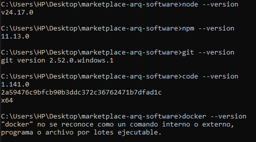
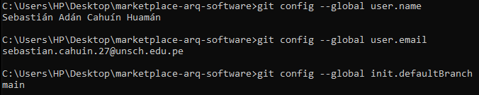
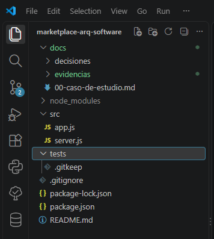

# Marketplace — Arquitectura de Software

## Datos académicos

- **Estudiante:** Sebastián Adán Cahuín Huamán.
- **Asignatura:** IS-488 — Arquitectura de Software.
- **Docente:** Ing. Lizbeth Jaico Quispe.
- **Universidad:** Universidad Nacional de San Cristóbal de Huamanga.
- **Semestre:** 2026-II.

## Descripción del curso

El curso aborda la organización y estructura de los sistemas de software,
sus componentes y las decisiones que permiten atender requisitos de
seguridad, rendimiento, disponibilidad y mantenibilidad.

## Expectativas del estudiante

Espero aprender a organizar un proyecto de software, comprender cómo
se relacionan sus componentes y justificar las decisiones arquitectónicas.
También quiero mejorar el uso de Git y GitHub para registrar avances
y colaborar de manera ordenada.

## Proyecto

Este repositorio corresponde al caso Marketplace. Su documentación
y código se desarrollarán progresivamente siguiendo las guías de
laboratorio del curso.

## Entorno de desarrollo

| Herramienta | Versión o estado |
|-------------|------------------|
| Node.js | 24.17.0 |
| npm | 11.13.0 |
| Git | 2.52.0.windows.1 |
| Visual Studio Code | 1.141.0 — x64 |
| Docker | Pendiente de instalación |

## Dependencias instaladas

- **Express 5.3.0:** dependencia de producción para el servidor web.
- **nodemon 3.1.14:** herramienta de desarrollo para reiniciar el servidor.

## Revisión de dependencias

La revisión con `npm audit --omit=dev` reportó cero vulnerabilidades.

La auditoría completa reportó tres alertas de severidad alta relacionadas
con la cadena `nodemon → chokidar → braces`. Esta incidencia queda pendiente
de una corrección compatible.

Referencia: https://github.com/advisories/GHSA-vfj7-8cjw-p6xm

## Evidencias del laboratorio 01

### Verificación de versiones

### Configuración de Git

### Creación del proyecto y estructura base

