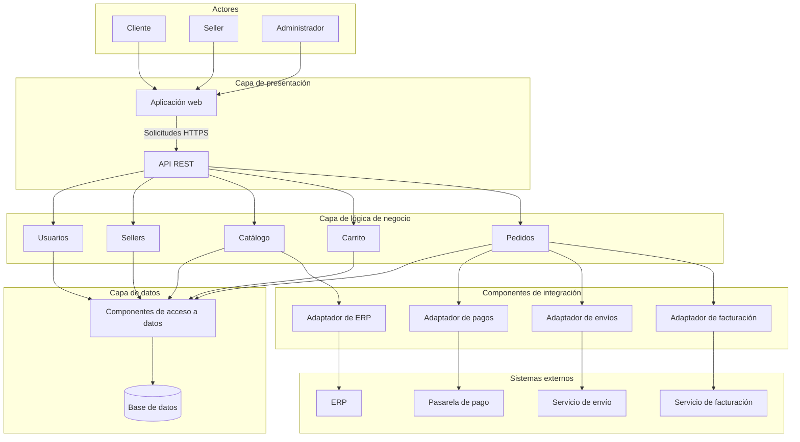

# Arquitectura inicial del Marketplace

## Arquitectura en tres capas

La propuesta inicial organiza el sistema en tres capas, cada una con
responsabilidades definidas.

| Capa | Pregunta que responde | Elementos | Responsabilidad |
|------|-----------------------|-----------|-----------------|
| Presentación | ¿Cómo interactúa el usuario? | Aplicación Web y API REST | Presentar información, recibir las solicitudes de los usuarios y comunicar sus resultados. |
| Lógica de negocio | ¿Qué hace el sistema? | Usuarios, Sellers, Catálogo, Carrito y Pedidos | Procesar las operaciones y aplicar las reglas del negocio. |
| Datos | ¿Dónde se almacena la información? | Base de datos | Almacenar y recuperar la información utilizada por el sistema. |

## Módulos de la capa de negocio

| Módulo | Responsabilidad |
|--------|-----------------|
| Usuarios | Gestionar la información de los usuarios y su acceso al sistema. |
| Sellers | Gestionar los vendedores registrados en la plataforma. |
| Catálogo | Gestionar los productos y permitir consultar su información y disponibilidad. |
| Carrito | Gestionar los productos seleccionados para la compra y sus cantidades. |
| Pedidos | Generar pedidos y permitir consultar su detalle y estado. |

## Relación entre las capas

La capa de presentación recibe las solicitudes y las comunica a la capa
de lógica de negocio.

La capa de lógica de negocio procesa las solicitudes y utiliza la capa
de datos cuando necesita almacenar o recuperar información.

Los resultados regresan a la capa de presentación para mostrarse al usuario.

## Diagrama de arquitectura

### Observación sobre el diagrama de referencia

El diagrama reproduce el ejemplo de la guía, que dibuja la flecha de
integraciones desde la capa de Datos. Sin embargo, la descripción de
la guía asigna al módulo de Pedidos la integración con la pasarela
de pago y el servicio de envío.