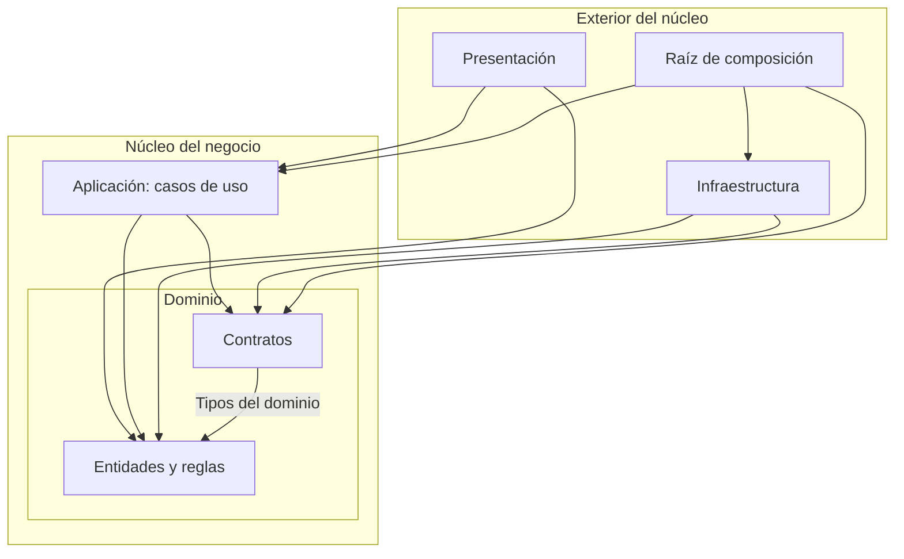
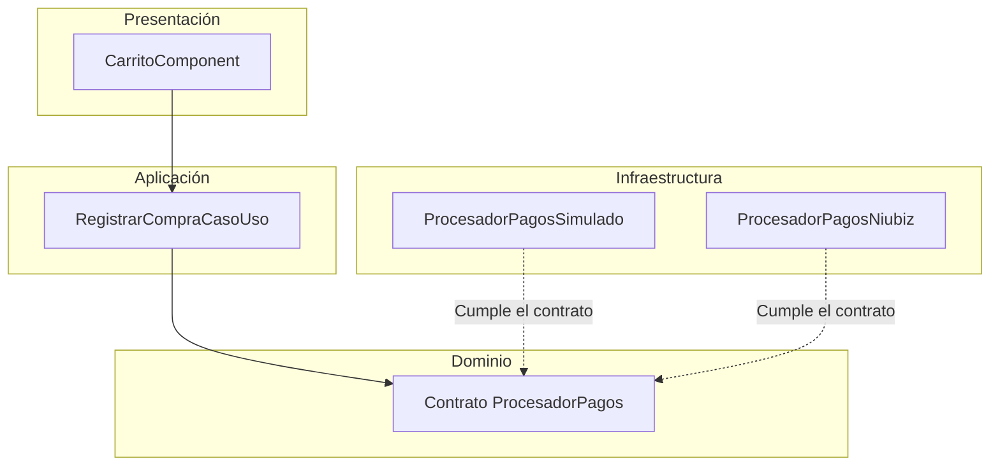

# Enfoque arquitectónico del Marketplace

## Enfoque seleccionado

Se adopta Clean Architecture para separar responsabilidades
y dirigir las dependencias hacia el núcleo del negocio,
conforme a ADR-002 y DA06 — Mantenibilidad.

El monolito modular define la organización global del backend.
Clean Architecture define cómo se organizan sus responsabilidades
y dependencias internas.

El boilerplate Angular permite estudiar este enfoque mediante
un ejemplo ejecutable de catálogo, carrito y compra.

## Las cuatro capas

| Capa | Responsabilidad | Ejemplos del boilerplate |
|------|-----------------|-------------------------|
| Dominio | Entidades, reglas y contratos del negocio. | Producto, Carrito, Pedido, reglas de precios y contratos de repositorios, pagos y notificación. |
| Aplicación | Coordinación de los casos de uso. | ConsultarCatalogoCasoUso, AgregarAlCarritoCasoUso y RegistrarCompraCasoUso. |
| Infraestructura | Implementaciones de contratos y mecanismos tecnológicos. | Repositorios en memoria y HTTP, procesadores de pagos, notificadores y tokens de Angular. |
| Presentación | Interacción con el usuario y comunicación de resultados. | CatalogoComponent, CarritoComponent, EstadoCarrito y AppComponent. |

En el backend propuesto, Presentación incluirá los controladores
de la API REST. En el ejemplo Angular, incluye los componentes
de la interfaz y su estado visual.

## Regla de dependencias

- Dominio utiliza sus propios modelos y reglas.
- Aplicación utiliza entidades y contratos del dominio.
- Infraestructura utiliza los contratos y modelos necesarios
  para implementar sus adaptadores.
- Presentación utiliza casos de uso y elementos del dominio
  para mostrar información.
- La configuración conecta las implementaciones desde fuera
  del núcleo del negocio.

Dominio y Aplicación deben mantenerse independientes
de Angular y de las implementaciones concretas de Infraestructura.

## Diagrama de dependencias

Las flechas resumen dependencias del código observadas
en las importaciones. No representan el orden de ejecución
de una compra.

Los contratos de repositorios utilizan modelos del propio dominio.
Los componentes de Presentación también pueden utilizar
estos modelos y las funciones de precios.

## Contratos e inversión de dependencias

Los contratos expresan lo que necesita el negocio.

Por ejemplo, ProcesadorPagos define la operación:

`cobrar(monto: number, medioPago: string): Promise<ResultadoCobro>`

ResultadoCobro contiene aprobado, codigoAutorizacion
y un motivoRechazo opcional.

RegistrarCompraCasoUso utiliza ese contrato. Los adaptadores
de pagos proporcionan sus implementaciones concretas.

El diagrama muestra el adaptador simulado y una alternativa
disponible en el ejemplo. La configuración selecciona
la implementación utilizada.

Durante la ejecución, el caso de uso invoca el procesador recibido.
En el código, depende del contrato del dominio.

## Raíz de composición

app.config.ts selecciona los adaptadores y construye
los casos de uso mediante useFactory y deps.

La configuración activa utiliza:

| Contrato | Implementación seleccionada |
|----------|-----------------------------|
| RepositorioProductos | RepositorioProductosMemoria |
| RepositorioPedidos | RepositorioPedidosMemoria |
| ProcesadorPagos | ProcesadorPagosSimulado |
| NotificadorCliente | NotificadorConsola |

Los tokens definidos en infraestructura/tokens.ts permiten
identificar estas dependencias durante la ejecución de Angular.

Los contratos permanecen en el dominio. El mecanismo de inyección
y la selección de implementaciones permanecen fuera del núcleo.

Las alternativas HTTP comentadas utilizan la dirección de una API
del backend. La integración real con proveedores externos
corresponde al diseño del backend documentado anteriormente.

## Verificación realizada

Se revisaron las importaciones estáticas mostradas por findstr:

- Las importaciones del dominio hacen referencia a sus propios modelos.
- Los casos de uso importan modelos y contratos del dominio.
- Los adaptadores HTTP utilizan Angular y RxJS desde Infraestructura.
- Los componentes utilizan Angular, casos de uso y modelos del dominio.
- app.config.ts conecta contratos, adaptadores y casos de uso.

Además, las 16 pruebas existentes pasaron mediante npm run pruebas,
sin iniciar la interfaz Angular.

El ejemplo también compiló y mostró el catálogo en el navegador.
Estas comprobaciones se realizaron con Node.js 24.17.0.

La revisión de importaciones y las pruebas aportan evidencia
complementaria sobre la separación y el comportamiento
de las partes examinadas.

## Beneficios y consecuencias

La separación facilita probar las reglas y los casos de uso
con adaptadores simulados.

También permite sustituir implementaciones técnicas cuando
se conserva el contrato requerido por el negocio.

Será necesario mantener los contratos, sus adaptadores
y la configuración que los conecta.

Los cambios deberán respetar la dirección de las dependencias
y los límites de responsabilidad definidos.
