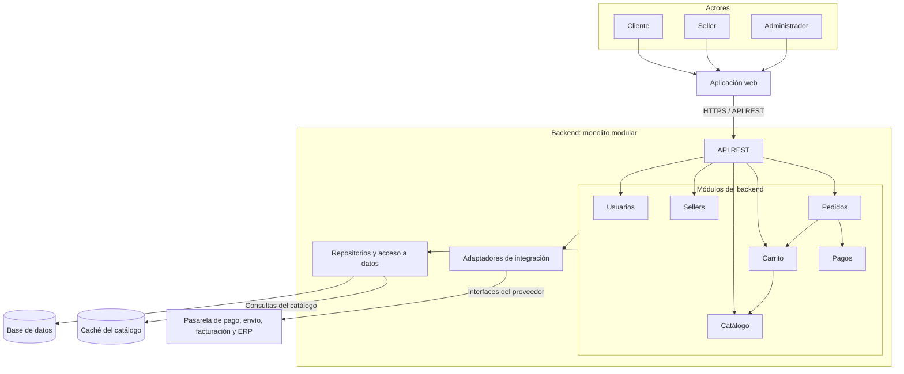

# Estilo arquitectónico del Marketplace

## Estilo seleccionado

Se adopta un monolito modular para el backend, conforme a ADR-001.

Sus módulos forman parte de una misma aplicación desplegable,
con responsabilidades y límites definidos.

La aplicación web actúa como cliente y se comunica con el backend
mediante una API REST, respetando RC01 y RC03.

La organización interna de responsabilidades y dependencias
seguirá Clean Architecture, conforme a ADR-002.

## Módulos del backend

La propuesta conserva los módulos identificados en el laboratorio 02
e incorpora un módulo de Pagos.

| Módulo | Responsabilidad |
|--------|-----------------|
| Usuarios | Gestionar cuentas, acceso y roles de clientes, sellers y administradores. |
| Sellers | Gestionar los vendedores registrados y su información comercial. |
| Catálogo | Gestionar y consultar productos, precios y disponibilidad. |
| Carrito | Gestionar productos seleccionados, cantidades y totales. |
| Pedidos | Coordinar las compras y gestionar los pedidos y sus estados. |
| Pagos | Coordinar el procesamiento de pagos mediante la pasarela externa. |

Los módulos se comunicarán mediante interfaces definidas,
respetando sus límites.

## Componentes y comunicación

La aplicación web recibe las acciones de los usuarios y envía
solicitudes HTTPS a la API REST.

La API valida el acceso y dirige las operaciones a los casos de uso
correspondientes.

Los módulos utilizan contratos para acceder a datos y servicios.
Los repositorios y adaptadores concretos pertenecen a Infraestructura.

La base de datos almacena la información gestionada por el Marketplace.
La tecnología de persistencia se definirá posteriormente.

La caché se utilizará para consultas frecuentes del catálogo,
con caducidad e invalidación, conforme a ADR-003.

## Integraciones externas

| Módulo responsable | Adaptador | Sistema externo | Restricción |
|--------------------|-----------|-----------------|-------------|
| Pagos, utilizado por Pedidos | Adaptador de pagos | Pasarela de pago | RC04 |
| Pedidos | Adaptador de envíos | Servicio de envío | RC05 |
| Catálogo | Adaptador de ERP | ERP de productos y stock | RC06 |
| Pedidos | Adaptador de facturación | Servicio de facturación | RC07 |

Los adaptadores se ejecutarán dentro del backend y utilizarán
las interfaces y formatos de cada proveedor.

La integración de pagos seguirá el contrato y los adaptadores
definidos en ADR-004.

## Diagrama de arquitectura

### Interpretación del diagrama

El contorno del backend reúne los componentes de una misma
aplicación desplegable. Los módulos representan divisiones internas.

Las flechas muestran comunicación y uso de componentes.
La dirección de las dependencias del código se establece
mediante Clean Architecture, conforme a ADR-002.

Pedidos utiliza la información del carrito y coordina el pago.
Carrito utiliza la información de productos del catálogo.

Los enlaces desde el grupo de módulos representan el uso de
repositorios y adaptadores cuando una operación los necesita.

Los adaptadores y sistemas externos se agrupan visualmente.
La tabla de integraciones identifica sus relaciones específicas.

## Justificación

- La modularidad responde a DA06 — Mantenibilidad, al delimitar
  responsabilidades y facilitar cambios.
- La organización permite plantear varias instancias del backend
  para responder a DA01 — Escalabilidad.
- La caché responde a DA02 — Rendimiento.
- La gestión de acceso y permisos responde a DA03 — Seguridad.
- Los adaptadores de pago responden a DA04.
- La comunicación mediante API REST responde a DA05.

## Consecuencias

El backend se desplegará como una unidad. Su escalamiento horizontal
replicará la aplicación completa y requerirá gestionar adecuadamente
el estado compartido.

La capacidad y los tiempos de respuesta deberán comprobarse
mediante pruebas de carga.

Los cambios internos deberán respetar los límites de los módulos
y la regla de dependencias.

## Alcance del laboratorio

Este documento describe la arquitectura propuesta para el Marketplace.

El boilerplate Angular utilizado en el laboratorio permite estudiar
las capas y ejecutar ejemplos con repositorios en memoria
y pagos simulados.